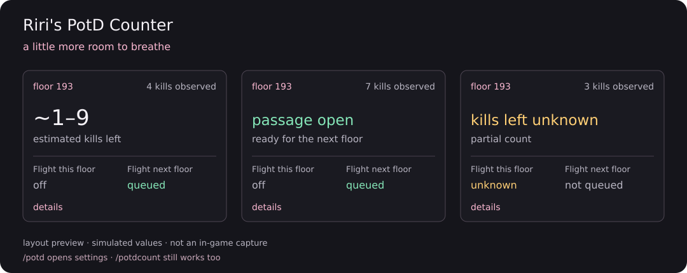
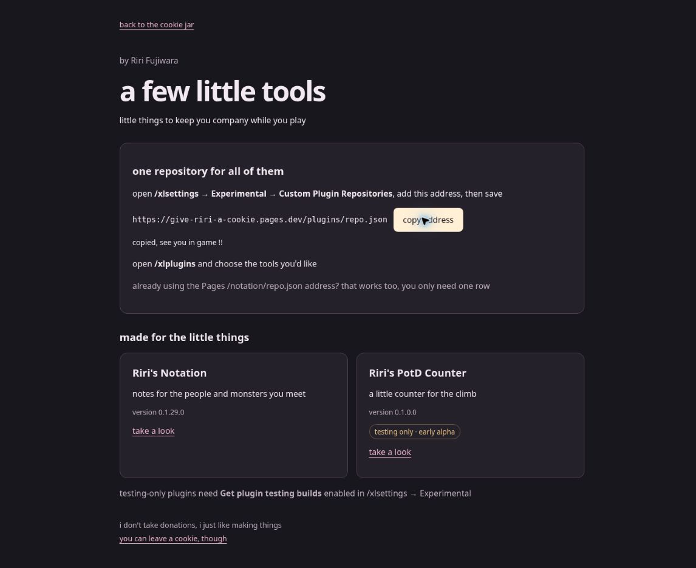

# Riri's PotD Counter

a little counter for the climb

*a layout preview with pretend values, in-game screenshots are still to come*

keeps track of the kills you see, your Flight pomanders, and roughly how much might be left
when the passage opens, it lets you know

no Flight required, the first floor still gets a kills-left estimate
if earlier kills or Flight are uncertain, the range gets wider and stays labelled

## come try it

1. add the [shared Riri repository](https://give-riri-a-cookie.pages.dev/plugins/repo.json) in `/xlsettings` → **Experimental → Custom Plugin Repositories** and save
2. enable **Get plugin testing builds**, then find **Riri's PotD Counter** in `/xlplugins` and install
3. open `/potd` to settle it into place, or `/potd preview` to try it outside PotD

`/potdcount` still works too

the big number is the rough **kills left**, with a clear **ACTIVE** or **INACTIVE** Flight badge
blue text means Flight is ready for the next floor, amber tells you a boss is ahead
open **run details** in `/potd` when you want the observed count and full floor range

already using the Pages `/notation/repo.json` address? that row works too, you only need one

the first alpha has a positive live PotD report, this update brings the approved glanceable HUD to the plugin
the new layout is still in testing while it gets an in-game look

[one address for my little tools](https://give-riri-a-cookie.pages.dev/plugins/)

[what changed](CHANGELOG.md) · [floor ranges](FLOOR_RANGES.md) · [technical details](TECHNICAL_DETAILS.md) · [MIT license](LICENSE)

by Riri Fujiwara
